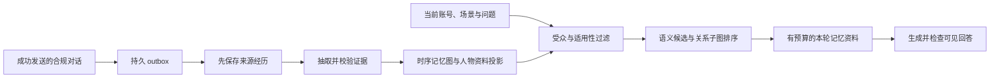

# Agent_test_api_based

基于模型 API 的模块化 QQ 对话与记忆系统。项目重点是**有来源、按账号和受众隔离、支持时序修订与撤销的长期记忆**：把成功对话整理为证据关联的记忆图，用本地文本编码与冻结 R-GCN 排序，并通过持久队列和版本校验处理后台任务的一致性。

对话通过 NapCat OneBot 接入，另有有预算的工具调用、独立公开面板，以及管理员明确指令下的空间动态任务。

这是脱敏的技术发布版：不含私人角色卡、原始提示词、实际 API 网关配置、密钥、QQ 账号、真实 UID 样例、聊天记录、记忆数据库、模型权重或生产运维证据。运行所需指令已重新编写为通用技术模板；默认提示词是中性示例，可在私有环境中自行配置。

## 记忆系统：核心设计

记忆系统分别处理四个问题：**什么值得记、记录来自哪里、当前是否适合使用，以及用户改口或撤回后怎样使旧记录失效**。短会话、长期记忆、表达偏好与训练导出各有独立边界。



| 技术 | 实现与作用 |
| --- | --- |
| 证据关联的记忆图 | Neo4j 保存人物、经历、主题、事实、偏好和任务六类节点；通过 `SUPPORTED_BY`、`SUBJECT` 等关系保留归属与来源。抽取结果必须提供用户原话中的连续证据，助手回答不能建立用户事实。 |
| 来源优先的异步整理 | 先保存成功对话的来源经历，再调用模型提取结构化候选；外部抽取暂时失败时，已保存的来源不随之丢失。事件 ID 与稳定节点 ID 支持重试去重。 |
| 分层、按用途召回 | 简单问候只返回适用称呼和表达偏好，不运行文本编码或 R-GCN；普通对话不自动召回旧经历，明确回忆或续接时才开放历史经历。 |
| 语义与关系联合排序 | 本地 Qwen3 Embedding 生成归一化向量，选取语义候选并扩展两轮关系邻居；两层冻结 R-GCN 参与评分，让命中的事实或计划可以关联回其来源讨论。 |
| 时间状态与遗忘 | 当前事实、历史经历、已完成任务分别处理。修订保留证据和失效状态；不同记忆类型采用不同半衰期，姓名、称呼及未完成任务有保留规则。衰减不会替代删除，也不会使已撤回记录重新有效。 |
| 身份与受众隔离 | actor 来自经校验 QQ 账号的 HMAC，scope 绑定账号与群/私聊场景。同账号称呼与适用表达偏好可延续，跨场景投影移除私聊来源细节；同名账号不会合并。 |
| 删除与后台一致性 | generation、账号锁、持久控制队列和失效记录共同约束写入；慢抽取返回后重新检查版本。撤销未同步时先阻断召回和 intake，不能用旧任务恢复已删除资料。 |
| 受限的反馈学习 | R-GCN 仅在离线合成数据流程训练，运行时冻结。用户显式反馈只更新账号级的小型排序层，分数调整限制在约 ±0.10，并绑定实际召回的账号、场景和回执。 |

**示例（完全虚构）**：用户曾说“我准备周末练习摄影”，后来问“之前说的那个周末安排是什么？”系统可以从计划节点找到支持它的来源对话。用户再明确说明计划已取消时，该计划转为失效状态；问候时也不会为了展示记忆而主动复述这个安排。

当前实现包括明确的候选数、子图规模、返回条数与字符预算。关系排序模型的训练任务是合成图中的证据来源检索，不能据此宣称真实聊天中的通用推理能力或准确率提升。

详见 **[记忆系统技术详解](docs/memory.md)**：数据模型、写入顺序、召回公式、R-GCN、时序更新、遗忘与反馈、撤销并发控制，以及实现限制和源码索引。

## 技术组成

| 目录 | 职责 |
| --- | --- |
| `src/qqbot` | 消息准入、会话编排、SSE/JSON 模型边界、唯一发送路径、存档、偏好、记忆协调与空间任务 |
| `src/qqmemory` | 图记忆 API、证据抽取、时序更新、受众过滤、离线编码、冻结 R-GCN 排序与有限反馈调整 |
| `bridge/yunzai` | 自主维护的只读公开展柜桥接、协议、上游版本与依赖锁定 |
| `config`、`deploy` | 无凭据的配置示例、服务清单与镜像定义 |
| `scripts`、`tests` | 统一检查、部署清单选择、捕获式联调与虚构测试数据 |
| `tools` | 首次配置、人工审核导出、固定上游获取与离线合成训练 |

每类服务一个入口：`python -m qqbot`、`python -m qqbot.tools.server`、`python -m qqmemory.app`；面板镜像使用 `node addon/bridge.mjs`。

## 本地检查

需要 Python 3.11+。Node 协议检查使用 Node 24；内存与图服务另有依赖。

```sh
python3 -m venv .venv
.venv/bin/pip install -e .
.venv/bin/python scripts/check.py bot --python-only
node --test tests/unit/test_protocol.mjs
.venv/bin/python scripts/audit_public.py
```

`scripts/verify.sh` 是容器检查入口，分别使用机器人、面板及记忆镜像。需要先构建镜像并启动用于测试的图服务。真实模型检查必须显式运行 `scripts/smoke.sh`；这些检查使用虚构账号、临时数据库及回复捕获，不向 QQ 联系人发送测试。

## 配置与部署

参见 [部署说明](docs/operations/runbook.md)。模型需支持聊天接口、结构化 tool calls、SSE 或 JSON，以及当前客户端使用的 thinking 参数；部署前确认服务商兼容性。环境变量名 `DEEPSEEK_*` 为客户端配置接口，并不包含任何凭据。

私聊直接提问；群聊使用 @、经校验的机器人消息引用或 `/ai`。`/help` 查看命令。保留记录同意、训练导出同意、语气学习开关及记忆撤销命令。真实聊天不会自动训练模型；训练导出需人工审核。

## 数据与权限边界

- 身份仅由校验后的 QQ 账号确定，显示名、引用、记忆和模型输出不能赋予权限。
- 同账号称呼与适用偏好可以延续，私聊资料不得进入其他群，群聊经历按场景过滤。
- 只有成功发送的合规非面板回答才进入长期记忆；失败发送不提交短会话。
- 工具清单来自可信安装，执行次数、轮数、参数、响应大小和超时有上限。
- UID 只接受真实会话的用户输入；图片只在当前发送动作使用，不进入模型、存档或记忆。
- 删除、暂停和修订遵守 generation、actor lock 与 tombstone；撤销同步失败时阻断召回和 intake。

详见 [架构说明](docs/architecture/overview.md)、[提示词与公开发布边界](docs/public-release.md)、[第三方组件说明](THIRD_PARTY_NOTICES.md)。

## 许可证

自主维护代码使用 [MIT](LICENSE)。上游项目、依赖、模型及游戏资源使用各自许可证，本仓库不重新授权这些内容。
