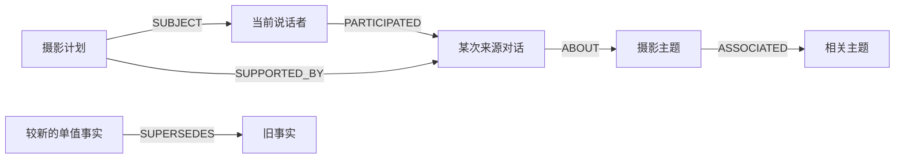
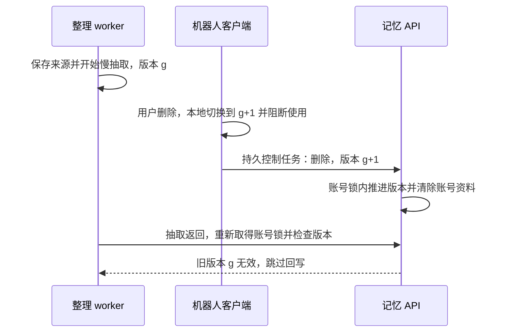

# 记忆系统技术详解

本项目把记忆拆成可检查的工程环节：记录准入、来源保存、候选抽取、证据校验、图结构整理、受众过滤、相关性排序、时序更新和撤销。模型负责提出候选、编码和辅助排序；账号归属、权限、状态有效性与写入条件由代码决定。

本文介绍当前源码实际实现的机制。所有对话示例均为虚构；不包含私人提示词、用户档案、运行数据或线上测试结果。

## 1. 四种状态，各有用途

| 状态 | 负责什么 | 进入条件与限制 |
| --- | --- | --- |
| 短会话 | 当前账号、当前场景的近期上下文 | 只恢复成功发送的普通聊天；有时间和条数上限，`/reset` 可清除 |
| 长期记忆 | 有来源的事实、偏好、计划和历史讨论 | 记录及记忆设置允许，且普通聊天成功发送、通过输出边界后才进入 intake；面板回答排除 |
| 表达偏好 | 长短、组织方式、表情等有限表达设置 | 独立偏好模块只接受校验后的枚举与有效来源；临时要求不永久写入 |
| 审核导出 | 经同意、人工批准的训练数据导出 | 与记录开关分开控制；聊天不会自动提交训练 |

长期记忆中的表达偏好和本地风格模块都只调节适用的表达方式，不能建立用户身份、权限或新的事实。它们的管理入口与持久状态不同，不应把“记忆学习”理解为在线更新聊天模型参数。

## 2. 用图保存归属、经历与证据

Neo4j 的 `Memory` 节点用 `kind` 区分六类内容：

| 节点类型 | 内容 |
| --- | --- |
| `person` | 当前账号在该场景的说话者标签；显示名只是元数据 |
| `episode` | 某次成功对话的来源记录，保存经准入清理后的用户输入及回答 |
| `topic` | 讨论主题，用于组织经历和相近主题的关联 |
| `fact` | 用户明确表达且通过校验的长期自述 |
| `preference` | 有来源的长期偏好，包括按槽位管理的表达偏好 |
| `task` | 尚需跟踪的目标、待办或明确约定 |

节点间有六种逻辑关系。数据库统一使用带 `relation` 属性的 `REL` 边：

| 关系 | 方向与用途 |
| --- | --- |
| `PARTICIPATED` | 人物 → 来源经历，记录谁参与了讨论 |
| `ABOUT` | 经历 → 主题，组织讨论内容 |
| `SUPPORTED_BY` | 事实/偏好/任务 → 来源经历，保留证据路径 |
| `SUBJECT` | 事实/偏好/任务 → 人物，明确内容属于谁 |
| `SUPERSEDES` | 新的单值事实 → 旧事实，表达时间上的替代 |
| `ASSOCIATED` | 相近主题之间的关联，辅助候选图扩展 |



例如“我准备周末练习摄影”可以产生一个任务候选，并通过 `SUPPORTED_BY` 指向实际讨论。随后询问此前安排时，可以检索任务与来源，而不只依赖某段摘要恰好重复问题中的词。

`Dossier` 是从有证据的节点整理出的资料投影，包含称呼、行为偏好、当前事实、进行中的计划等；`Revision` 保存修订请求及结果。资料投影不是另一份可独立编造事实的模型档案。没有来源和证据的候选不会进入正常的事实整理。

实现：[graph.py](../src/qqmemory/graph.py)、[dossier.py](../src/qqmemory/dossier.py)、[共享策略](../src/qqbot/memory/policy.py)。

## 3. 从成功发送到长期写入

写入顺序决定了机器人能否把失败回答、模型想象或已撤回任务带进记忆：

1. 前台先检查最终可见回答，并调用 OneBot 发送。成功后才提交短会话、标记存档 delivered，安排长期记忆 intake。失败发送不生成这次长期 intake。
2. 机器人将事件写入 SQLite outbox。事件携带 actor、scope、generation、事件 ID、来源时间和本次对话数据。
3. 记忆 API 验证输入形状、版本及账号状态，把事件放进服务端的持久 jobs 队列。
4. 整理 worker 先在账号锁内保存来源经历及其本地向量，再进行外部模型抽取。抽取失败时，已经保存的来源经历仍在。
5. 抽取结果必须通过纯策略校验；worker 在慢抽取返回后重新取得账号锁、检查 generation，才写入有效候选、关系和修订。
6. 更新资料投影，并在同一账号、场景内连接相近主题。当前主题关联阈值是归一化向量点积 `0.70`，每个新主题至多选两个相近主题。

抽取只允许从用户输入取得事实证据，助手回答仅辅助理解讨论。每条 claim 的 evidence 必须是来源输入中连续、逐字相同的 4～240 字，候选值不超过 160 字，且字段、数量和 temporary 标记都受检查。凭据、UID、面板内容、引用、假设、第三者身份和临时要求等受独立规则限制。

“曾讨论过某场景”也不等于“该场景真实发生在用户身上”。历史经历进入模型资料时优先呈现用户原话节选，附上历史与来源角色标记；假设和故事不能被直接改写成用户的现实经历。

这些检查减少已知形式的归属和注入问题，但连续证据校验并不证明模型对证据的解释一定正确，也不核实用户自述的外部真实性。

实现：[coordinator.py](../src/qqbot/memory/coordinator.py)、[client.py](../src/qqbot/memory/client.py)、[api.py](../src/qqmemory/api.py)、[consolidation.py](../src/qqmemory/consolidation.py)、[extract.py](../src/qqmemory/extract.py)。

## 4. 先决定可见和适用，再进行排序

召回首先处理身份、受众与用途，排序不能突破这些硬边界。

账号和场景标识由机器人对经过 OneBot 校验的账号生成：

```text
actor = HMAC-SHA256(salt, "user:" + user_id)
scope = HMAC-SHA256(salt, "scope:" + group_or_private + ":" + user_id)
```

同名账号不会合并，模型和用户自称换号都不能建立账号映射。记忆 API 信任持有服务凭据的机器人客户端提供的身份与场景，不直接连接 QQ 认证用户；因此服务令牌也必须受到保护。

在同账号下，私聊视图可读取本人各场景内符合条件的资料；群聊视图默认仅包含当前场景，另允许本人称呼、语言和适用表达偏好延续。跨场景投影会移除私聊来源原文、问答及经历细节，不把姓名或昵称当作权限依据。

HMAC 是账号标识的去直接标识化，不是正文加密，也不使原始对话天然匿名。数据库、存档和密钥仍需受保护，账号盐必须稳定。

过滤后，再按问题用途分流：

| 用途 | 送入本轮的记忆 |
| --- | --- |
| `social`：问候、感谢、简短应声 | 适用称呼与表达偏好；不运行查询编码或 R-GCN 排序 |
| `chat` / `focused`：普通交流或具体任务 | 适用资料及通过筛选的事实/偏好/任务；旧经历被适用性规则排除 |
| `recall`：明确回忆或续接 | 允许检索有来源的历史经历，并放宽数量与文本预算 |
| 面板查询 | 跳过长期记忆；UID 仍只由真实会话用户输入授权 |

问候偏好只在真正问候或明确查询该约定时适用。资料中的旧版“共同经历汇总”保留在管理用途，模型输入优先使用有来源的单条经历。服务端排序和机器人输入边界都调用共享纯策略做适用性检查，以兼容分阶段升级。

`social` 路径仍会查询受众资料视图，不能据此声称完全没有图查询或给出未经测量的延迟提升。

实现：[applicability.py](../src/qqbot/memory/applicability.py)、[policy.py](../src/qqbot/memory/policy.py)、[GraphStore.view](../src/qqmemory/graph.py)、[MemoryAPI.recall](../src/qqmemory/api.py)。

## 5. 语义种子、关系扩展与联合评分

### 本地向量编码

编码器使用本地 Qwen3-Embedding-0.6B，CPU 推理，禁止运行时下载和远端自定义模型代码。文本先做长度限制，再以最多 256 tokens 编码，取最后位置的隐状态并做 L2 归一化。查询添加公开的检索任务前缀，文档与查询缓存分开。

SQLite 向量缓存键包含模型修订、查询/文档用途和输入内容的 SHA-256。缓存是可重建的派生状态，图中的来源与有效性状态才是事实依据。长输入存在截断限制，不能保证任意长度对话的信息都进入向量。

### 候选与证据扩展

1. 在受众过滤后的可用向量上计算点积相似度；向量已归一化，因此这里使用余弦相似度。
2. 取语义相似度最高的最多 30 个节点作为种子。
3. 沿允许视图中的关系扩展两轮邻居，形成约 160 节点的有界子图；代码按边成对加入节点，边界处可能多一个节点。
4. 不以人物节点继续扩展，避免某个账号的所有经历仅因共享人物节点而被全部带入。
5. 相关事实、偏好或任务可以通过 `SUPPORTED_BY` 激活它的来源经历，使来源摘要未重复查询词时仍有机会进入候选。

当前源码的激活量和最终排序可概括为：

```text
activation(i) = max(semantic(i), 0.9 × semantic(支持该经历的候选))
score(i) = 0.75 × activation(i)
         + 0.25 × sigmoid(rgcn_logit(i))
         + bounded_feedback(i)
         + 0.03 × retention(i)
```

非经历节点没有“支持该经历的候选”这一项。来源激活也只针对已达到门槛的证据邻居：显式回忆类措辞采用 `0.25` 的激活门槛，其余采用 `0.40`。门槛、系数和规则是当前工程配置，未经真实数据评测时不应称为最优参数。

`sigmoid(rgcn_logit)` 是用于混合评分的变换值，**不是事实正确率或经过校准的置信度**。排序只决定在已允许的候选中优先取什么，不生成新事实，也不能覆盖撤销状态。

### 返回预算

| 模式 | 记忆项上限 | 历史经历上限 | 记忆项序列化预算 |
| --- | --- | --- | --- |
| 明确回忆 | 7 | 3 | 2200 字符 |
| 其他非问候模式 | 3 | 1 | 1100 字符 |

普通模式的旧经历会在前面的适用性过滤中排除，因此其经历数量通常为零。资料投影另有 1800/1000 字符预算，不能把表中数值理解为整个模型请求的总 token 上限。默认受众图查询最多读取 1200 条原始节点记录；当前向量候选阶段是对该有界视图做线性计算，没有独立 ANN 索引。

实现：[encoding.py](../src/qqmemory/encoding.py)、[recall.py](../src/qqmemory/recall.py)、[dossier.py](../src/qqmemory/dossier.py)。

## 6. R-GCN 怎样使用关系信息

关系图卷积网络为不同关系使用不同的消息变换，分别聚合邻居，而不是把所有边当成同一种相似链接。当前模型的配置为：

| 项目 | 当前实现 |
| --- | --- |
| 语义投影 | 用固定随机投影将编码向量映射到 96 维，再归一化 |
| 节点输入 | 96 维语义 + 6 维类型 one-hot + 年龄、访问次数，共 104 维 |
| 图关系 | 6 种逻辑关系，加各自逆向边，共 12 类 |
| 图网络 | 两层 R-GCN，隐藏维度 64，按关系做平均邻居聚合并加自身变换 |
| 查询匹配 | 查询投影到隐藏空间，与归一化节点表示做匹配，使用有界温度缩放 |
| 在线状态 | 加载校验过的权重，`eval()` 与 `inference_mode()`；不从真实聊天反向传播 |

这使“某个计划由哪次讨论支持”这样的结构关系可以参与排序。它并不执行通用逻辑证明，也不承担身份认证、事实核实或权限判断。

离线训练工具用人为编写的虚构计划构造图，把计划随机连接到不同经历，要求模型找出正确的支持经历。训练/验证/测试分别为 100/40/60 个合成样例；验证与测试使用独立随机种子和改写问法。训练目标是候选经历的交叉熵分类，并与仅比较经历文本向量的基线记录对照。

脚本在选模后对新的合成测试集检查阈值，保存权重哈希、编码器修订、特征/关系规格和评测范围。运行时会核对这些元数据。合成训练没有覆盖的 `SUPERSEDES`、`ASSOCIATED` 及其逆向消息权重会清零，时间替代与主题关联仍由显式图策略处理。

**这些样例和验收阈值不是真实聊天效果报告。** 仓库不分发原运行权重，也没有用这次脱敏发布的真实模型/图服务联调证明召回提升；部署者需要按公开工具准备模型并重新评估。

实现：[neural.py](../src/qqmemory/neural.py)、[合成训练工具](../tools/models/train.py)。

## 7. 新旧事实、修订与任务状态

同一场景内，姓名、偏好称呼、居住地、职业和语言等单值字段按时间处理替代关系：晚于当前值的新陈述使旧值结束有效期，并保留 `SUPERSEDES` 路径；迟到的旧事件不能成为较新值的替代者。

自然语言可提出 `retract`、`correct`、`complete`、`cancel` 更新候选，最终仍要通过证据、字段、目标和时间检查。目标匹配不唯一时返回需要澄清的结果，不猜测用户究竟要改哪一条。`pin` / `unpin` 只由显式命令处理。

显式修订将旧节点标为 inactive，记录 `valid_to`、状态和修订来源；相应来源经历标为 invalidated，避免旧来源再次进入普通召回。更正另建立有新证据的有效记录。`Revision` 的稳定 ID 使同一修订重试可返回既有结果。

这限制的是过时任务和旧证据的恢复。用户在更晚时间重新明确声明同一个偏好，与旧任务重试是不同情况，不能把“防复活”误解为永远禁止再次记录某个值。

例如：用户先说“周末练摄影”，随后明确取消该计划，任务状态应变为 cancelled；后台重试旧事件不能把它重新当作未完成任务。

实现：[GraphStore._add / _update](../src/qqmemory/graph.py)、[checked_extraction / checked_update](../src/qqbot/memory/policy.py)。

## 8. 遗忘与显式反馈

有效记忆的召回强度采用指数衰减，并根据重复证据、访问与显式有用反馈延长保留时间：

```text
retention = exp(-ln(2) × age / adjusted_half_life)
```

| 类型 | 基础半衰期 |
| --- | --- |
| 来源经历 | 14 天 |
| 主题 | 30 天 |
| 一般事实 | 90 天 |
| 长期偏好 | 180 天 |

年龄从最近观察或正向强化时间计算。读取的增益有上限，重复来源和明确的有用反馈也有各自的增益上限。姓名、偏好称呼、语言、人工固定的项目，以及仍有效的未完成任务按代码规则保留。

普通模式隐藏低于 `0.15` 的低强度内容，明确回忆模式可保留低强度的有效记录。衰减本身不物理删除数据；inactive 或 invalidated 内容也不会因低阈值回忆模式而恢复。用户删除由独立撤销流程处理。

反馈学习是一个按账号保存的七维逻辑回归层，特征包括语义分数、关系分数、保留强度、节点类型、回忆模式与访问次数。它只接受 `/记忆反馈` 对实际曝光回执的明确标签：

- 回执同时绑定 actor 与 scope，不能跨账号或跨场景使用。
- 同一回执只处理一次，避免重复反馈累积。
- 至少累计四次反馈后才启用个性化分数调整，幅度限制在约 `[-0.10, +0.10]`，参数本身也有限幅。
- 反馈还会更新节点的有用计数与强化时间，但不会修改事实内容、受众权限或冻结的 R-GCN 权重。

一次“这次记忆有用/无关”会标记该回执里的一组召回项，属于粗粒度相关性反馈；它不是逐项的事实真伪标注。

实现：[lifecycle.py](../src/qqmemory/lifecycle.py)、[attention_model.py](../src/qqmemory/attention_model.py)、[feedback API](../src/qqmemory/api.py)。

## 9. 删除为什么需要版本、锁和持久队列

仅从数据库删掉节点，不能阻止已经发出的慢模型请求稍后把旧内容写回来。当前实现组合三层控制：

1. **本地立即阻断。** 机器人把账号 generation 递增，清理旧待发送项并持久化控制任务；控制未确认期间，前台停止该账号的召回和 intake。
2. **控制优先同步。** outbox 总是先同步控制操作，再同步资料。连续暂停/恢复不会覆盖尚未完成的 forget；恢复了旧版本备份而与服务冲突时，保持关闭状态，等待人工核对。
3. **服务端复核。** 控制、读写与整理的关键段共享账号级 asyncio 锁。外部抽取在锁外运行；返回后重取锁、检查 generation 与 enabled，再决定是否写入。旧版本 jobs 被清理或跳过。



forget 会删除该账号的图节点、资料投影、修订及反馈状态。由于向量缓存键按内容和模型修订组织，没有可靠的账号归属列，删除时采用清空全部派生向量缓存的保守方式；其他账号的权威图资料仍保留，后续可重新编码。这有缓存预热成本。

outbox 的容量上限为 1000 项，服务 jobs 队列的 pending/processing 上限为 500 项；队列满时拒绝继续积累。服务整理任务至多尝试三次，失败任务结束后清除 payload。来源 ID、稳定节点 ID 及修订 ID 为各阶段提供去重；这里没有跨 SQLite、Neo4j 与模型服务的分布式事务，不能宣称任意故障下全链路严格 exactly-once 或绝不丢失。

删除确认依赖真实同步结果，网络失败时只说明已停止使用并等待重试。已人工导出的文件或独立备份不属于在线删除范围，仍需另行处理。

实现：[MemoryClient.control / flush](../src/qqbot/memory/client.py)、[jobs.py](../src/qqmemory/jobs.py)、[MemoryAPI.control](../src/qqmemory/api.py)、[Consolidator.worker](../src/qqmemory/consolidation.py)。

## 10. 可观察验证与适用范围

| 检查 | 对应源码 |
| --- | --- |
| 失败发送不提交短历史、不进入长期 intake | [test_composition.py](../tests/unit/test_composition.py) |
| 撤销版本、持久 jobs 与输入证据限制 | [test_policy_jobs.py](../tests/unit/test_policy_jobs.py) |
| 账号/场景隔离、旧 outbox 冲突与发送边界 | [test_adapter.py](../tests/unit/test_adapter.py) |
| 同账号跨场景投影、任务状态及反馈隔离 | [test_memory_v3.py](../tests/unit/test_memory_v3.py) |
| 问候偏好、历史经历适用性及引用归属 | [test_memory_applicability.py](../tests/unit/test_memory_applicability.py) |
| 图排序候选、经历激活与相关性边界 | [test_neural_recall.py](../tests/unit/test_neural_recall.py) |

上述部分检查需要图服务、模型依赖或本地模型资源；不能因为文件存在就宣称已经运行。公开发布的实际验证范围见 [validation.md](validation.md)。这次技术介绍仅修改文档，不改变记忆算法或重新运行真实服务。

适用性分流和人物归属仍包含词面规则，不能覆盖所有自然语言表达；结构化证据校验也不能代替语义核实。图视图、候选和编码均有边界，当前实现不是无限规模知识图谱或通用推理系统。它的可检查价值在于把来源、身份、用途、排序和撤销分别落到明确的模块与状态契约上。
